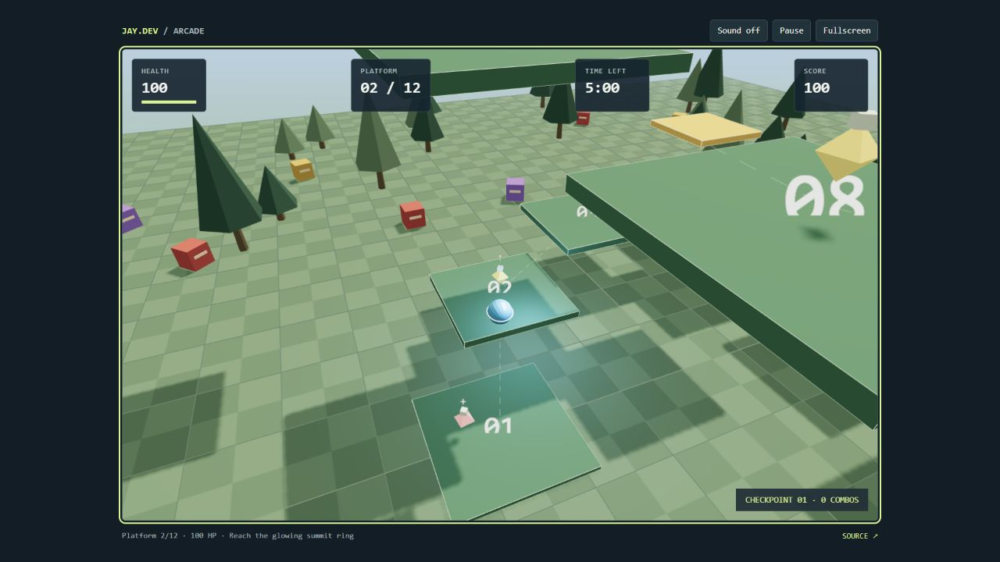

# 8-bit Bounce

A personal 3D platformer by Jaygovindhan Neelanarayanan. Climb a spiral of floating platforms, ride moving platforms, avoid cube enemies and collect healing or high-bounce pickups. Reach the summit or survive five minutes.

**[Play the interactive browser demo](https://jaygoneelz.github.io/games/8bit-bounce/)** · [Portfolio](https://jaygoneelz.github.io/)



The browser demo is a simplified recreation of the gameplay. The original C++/OpenGL game has different graphics, assets and physics.

## Two editions

| Edition | Technology | What is included |
| --- | --- | --- |
| Native desktop | C++17, OpenGL, Bullet, FMOD, Assimp, FreeType | Game and engine source, Visual Studio solution, project files, shaders, models and textures |
| Browser adaptation | JavaScript, Three.js / WebGL 2 | A playable 3D interpretation of the same spiral-climbing mechanics, with checkpoints, a full restart flow, keyboard/touch controls and local records |

The browser edition is an adaptation, not the native C++ executable compiled to WebAssembly. Its scenery and sounds are generated in code; it does not distribute or emulate FMOD or Bullet. Native and browser physics are separate implementations.

## Browser controls

| Action | Controls |
| --- | --- |
| Move relative to camera | WASD / arrow keys |
| Jump | Space |
| Rotate camera | Drag the scene or Q / E |
| Pause / resume | P / Escape, or the toolbar |
| Toggle sound | M or Sound button |
| Collision boxes | B |
| Touch devices | Direction pad, Jump and camera buttons |

Follow the numbered platforms. Gold platforms are moving side routes. Yellow pickups increase jump strength for five seconds; pink pickups recover 20 health. Every third platform activates a checkpoint. Falling off the island costs 25 health and returns you to the checkpoint. Gold scouts detect farther away, red hunters move faster, and purple guards hit harder. Enemies periodically investigate hiding players and recover briefly after attacks. Alternate pickup types within eight seconds for a combo bonus. Both the summit ring and the five-minute survival timer lead to victory.

## Run the browser source locally

Serve `Web/` through HTTP, then open its local URL. For example, with Python installed:

```powershell
python -m http.server 8000 --directory Web
```

The browser runtime is self-contained. Three.js `0.180.0` and its MIT notice are bundled in `Web/vendor/`; there is no runtime CDN or account requirement. `Web/config.json` controls the spiral and movement rules. Scores are stored only in the current browser/device under the local-storage key `jay.8bitbounce.records.v1`.

Run the simulation checks with Node.js:

```powershell
node --test Web/tests/core.test.mjs
```

## Native project

Open `engine.sln` with Visual Studio C++ tools, the Windows SDK and the v143 toolset. The verified configuration is **Debug / x64**. See [native setup](docs/Native-setup.md) before building: FMOD SDK files, precompiled dependency libraries and the Arial font binary are intentionally not published. A fresh clone requires those local dependencies.

The engine is based on an existing MIT-licensed template. Its original copyright notice is retained in `LICENSE.MD`, and third-party source notices remain in place. Game-specific logic lives in `game/src/example_layer.cpp` and in the player, enemy, platform, pickup and game-manager classes under `engine/src/engine/`.

## Project notes

- [Architecture](docs/Architecture.md): original game structure, browser simulation and adaptation choices.
- [Implementation](docs/Implementation.md): collision conventions, state diagrams, camera queries, rendering and startup fixes.
- [Design review](docs/Design-review.md): strengths, limitations and next steps.
- [Native setup](docs/Native-setup.md): dependency locations and build status.
- [Testing](docs/Testing.md): automated and browser checks, including the full summit route.
- [Credits and dependencies](docs/Credits.md): template attribution, vendored libraries and asset provenance.

The browser uses swept top-surface landing tests and sphere/box responses rather than a general rigid-body physics engine. Records are local and editable, not an online leaderboard. Desktop release builds, mobile hardware coverage and extended balance testing remain separate work.
