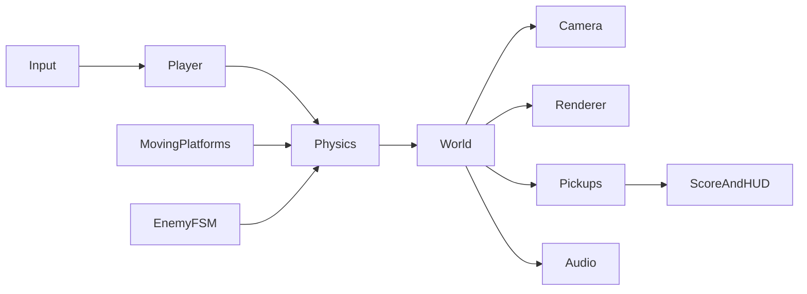
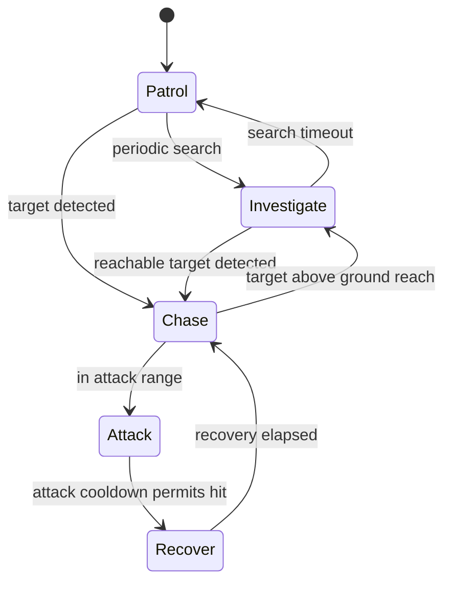
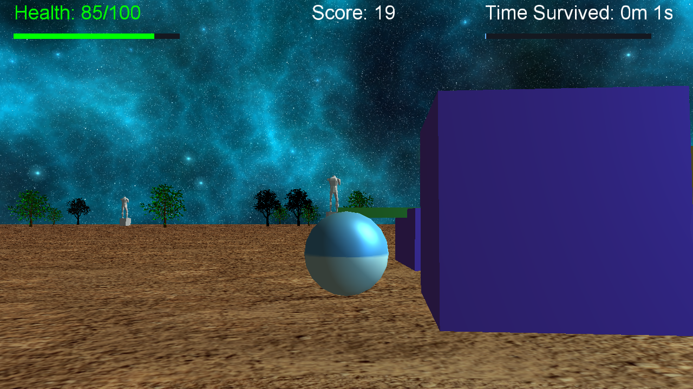

# Implementation notes

## Scene and update ownership

The desktop and browser editions share an idea and level dimensions, but implement their own physics. The native edition uses C++ and Bullet; the browser uses a deliberately small sphere/box simulation. Features and tests for one edition are not evidence that the other edition behaves identically.



The native layer owns the world, renders through the retained engine and delegates rules to `Player`, `Enemy`, `MovingPlatform`, `PowerUp` and `GameManager`. The browser keeps rules in `Web/core.js`; `main.js` converts simulation state into geometry, sound and visible UI. This lets the route, health and AI run without a graphics context in automated tests.

## Collision sizing and imported models

`bounding_shape` is a local-space half-extent. Bullet applies object scale once when it builds the collider:

```cpp
// EnvironmentGenerator: model-space dimensions, not world dimensions.
props.bounding_shape = model->size() * 0.5f;
props.scale = glm::vec3(random_scale);
object->set_offset(model->offset());
```

Previously, tree/statue sizes already included scale before reaching Bullet, producing squared scale and walls that disagreed with the visible model. The generator now keeps local bounds, places each model's centre above the ground and uses the model offset in the rendered transform. Statue size is normalized before random variation. Collision debug boxes use the same scaled dimensions as Bullet.

These are conservative boxes, not detailed triangle colliders. A tree's branches and gaps within a statue can still differ from its enclosing box. Rotated irregular scenery would need oriented bounds or compound/convex shapes and an offset applied in the correct rotated space. Current generated scenery has no authored rotation.

`bullet_manager::dynamics_world_update` reuses the body's existing motion state, updates its world transform and refreshes its broadphase box. It no longer allocates a motion state for every object on every frame. Player forces produce acceleration; a horizontal speed limit and drag bound movement. Sphere restitution produces the moving light orb's bounce.

## Moving platforms and jump route

The spiral has twelve main platforms with radius eight, 45-degree spacing and 1.5-unit vertical steps. Three horizontal and two vertical movers occupy outer routes. Their displacement is calculated after interpolation, so a rider receives the current frame's movement rather than the previous frame's movement.

```cpp
current_position = glm::mix(m_start, m_end, m_progress);
m_platform_delta = current_position - m_last_position;
m_platform->object()->set_position(current_position);
```

Native jump velocity is eight units/second. The browser uses its separately configured gravity and jump velocity, a fixed 60 Hz accumulator, swept feet-to-platform landing tests, sphere/box side responses, a jump buffer and a coyote interval. Its full-route test climbs every main platform without boost pickups. That test deliberately removes enemies to isolate geometric reachability.

## Enemy roles and state transitions

Twenty enemies use five active states. Scouts detect farther away, hunters move faster, and guards deal more damage. The native role assignment derives from spawn position; browser roles cycle deterministically.



Native movement sets horizontal velocity, leaving vertical integration and contacts to Bullet. Browser movement multiplies speed by the simulation step. Both avoid the old fixed-distance-per-render-frame movement. Recovery cannot be cancelled by range checks. Player invulnerability lasts 0.9 seconds, preventing a group of enemies from draining all health in one instant.

The search behaviour closes the easy ground-level hiding strategy: remaining beyond the detection radius no longer guarantees safety. Elevated platforms intentionally remain useful refuges. This is local pursuit with no navigation mesh, obstacle-aware pathfinding or line-of-sight claim; a blocked enemy can still require a route around scenery.

## Camera obstruction

The native orbit camera tests the segment between its target and desired position against expanded static collision boxes. Slab intersections shorten the boom before the camera enters an obstacle; a minimum height prevents it going below the terrain. The browser uses a ray against expanded platform boxes and immediately retracts on an obstruction, then eases outward. Browser trees are decorative and are not included in that collision query. This prioritizes visible platform clearance without claiming full-scene collision coverage.

## Rendering, lighting and effects

Native rendering enables two actual point-light entries in addition to the directional sun: a blue light follows the bouncing physics orb and a green beacon sits at the summit. Attenuation uses a non-zero constant to avoid division by zero. Terrain UVs repeat forty times instead of stretching one image. The sphere, cuboid, cone and cylinder retain UVs and normals; the new generated checker texture is used by the player and spirits. Imported mesh types remain elm, maple, statue and potion.

Native effects include distance fog, alpha-blended animated spirits, additive pickup glow and the existing summit sparkle particles. Fog measures camera-to-world distance and clamps its blend factor. Spirit depth writes are disabled for their translucent pass and restored afterwards; intersecting transparent objects are not fully sorted.

The browser uses a hemisphere light, directional sun and two dynamic/local point lights; generated checker terrain; shadows; distance fog; a portal; and short-lived jump/pickup/damage/checkpoint particles. Expired particle geometry/materials are disposed. A pickup boost increases the moving light intensity. These effects are separate from the native shader implementation.

## Rules, restart and audio

Healing restores twenty health up to 100. Bounce increases jump velocity 1.5 times for five seconds; it does not grant a double jump. Both editions award a combo for alternating pickup types within eight seconds. Native pickups now appear along the spiral as well as on the ground. Each combo is worth 100 points.

Native game-over freezes world updates and distinguishes victory from defeat. Restart resets player health, position, velocity, boost, enemy state/positions, pickups, moving-platform progress, HUD notifications and timers. Native health and survival progress bars supplement text. The browser recreates the whole simulation, preserves local records and provides checkpoints, pause and touch controls.

Native FMOD playback retains music and spatial sound events. Browser sound uses synthesized effects and a short repeating background pattern after the player enables sound. Muting stops future tones; notes already playing decay within a fraction of a second. Pausing stops new music notes.

## Startup reliability

The renderer previously requested `particle_shader.glsl`, which was absent and unused. Loading an empty shader then accessed an empty compiler-log vector. The unused request is removed. The loader rejects empty stage maps, allocates at least one byte for error logs, records only real shader handles and deletes detached shaders after successful linking.

The optional `BOUNCE_SMOKE` check starts a hidden native window, advances 120 fixed gameplay frames, writes a PPM screenshot and exits. Assertions go to its test log instead of desktop pop-ups. It is a startup/rendering check, not proof of every collision or user interaction.


